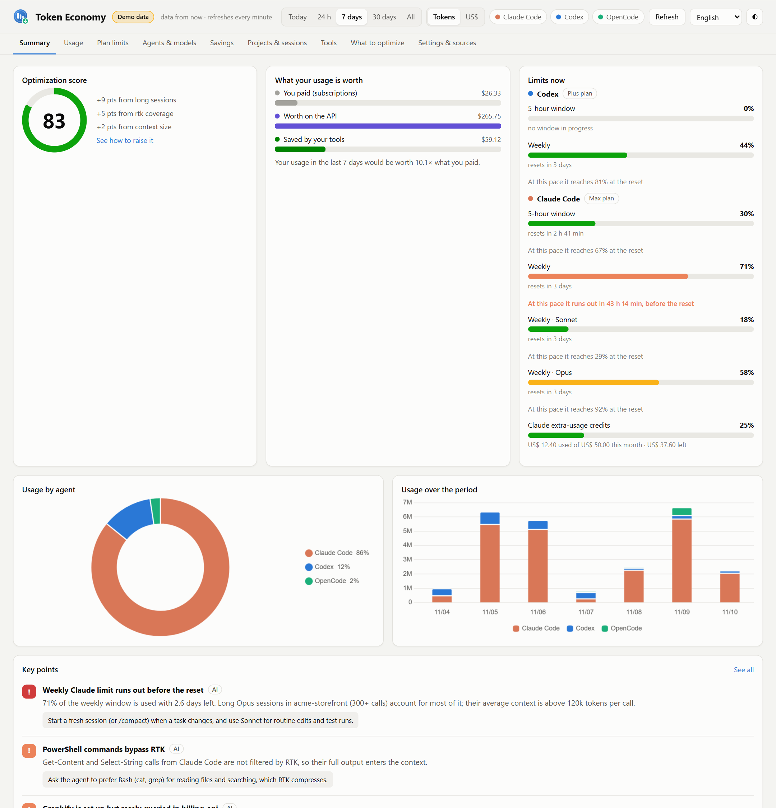
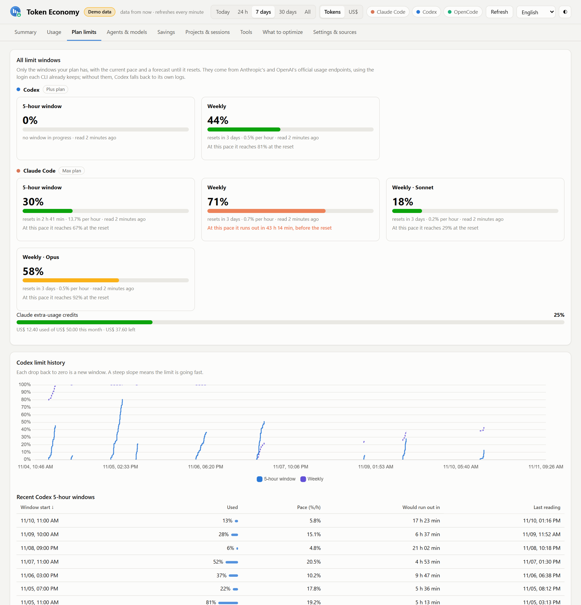
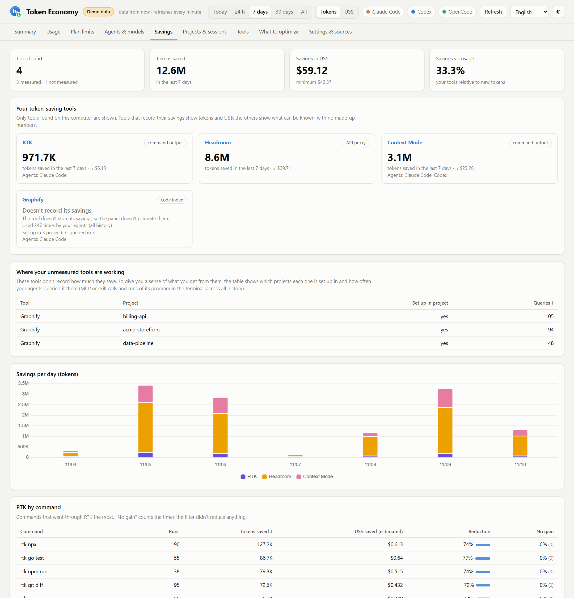
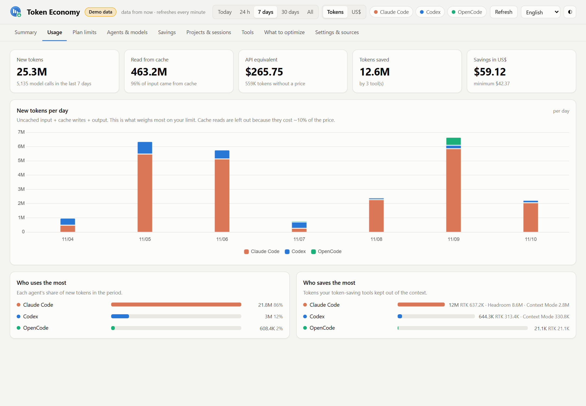
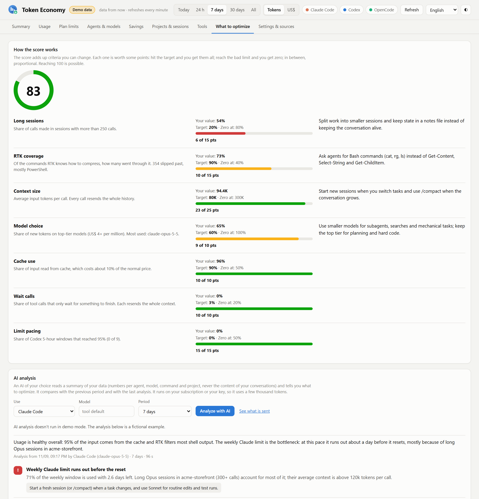

# Token Economy: panel de consumo, límites y ahorro de tokens de Claude Code y Codex

**Mira cuántos tokens gastan tus agentes de IA, cuánto te falta para los límites del plan de Claude Code y Codex, y cuánto ahorran de verdad tus herramientas de ahorro (RTK, Headroom, Context Mode, Graphify…).** Panel local y app de bandeja para Windows. Sin cuenta y sin telemetría: lee los registros que ya están en tu computadora.

[English](README.md) · [Português](README.pt-BR.md) · [Apoya el proyecto](#apoya-el-proyecto)



## Para qué sirve

Claude Code, Codex, OpenCode y compañía gastan millones de tokens por semana, y cada uno guarda sus números en un lugar distinto. Token Economy los pone uno al lado del otro:

- **Límites del plan en tiempo real.** Ventanas de 5 horas y semanal de Claude Code (incluida la cuota semanal por modelo) y de Codex, con pronóstico: "a este ritmo llegas al 81 % cuando se reinicie" o "se acaba en 3 días, antes del reinicio".
- **Consumo de tokens por agente, modelo, proyecto y sesión.** Entrada, salida, lectura y escritura de caché, por día.
- **Cuánto costaría tu uso por la API**, comparado con lo que pagas en suscripciones, proporcional al período elegido.
- **Herramientas de ahorro medidas con honestidad.** Detecta lo que tienes instalado y muestra solo eso. Las que registran su ahorro muestran tokens y US$; las que no, lo dicen y muestran en qué proyectos están configuradas y cuántas veces las usaron tus agentes. Nunca inventa un número.
- **Una nota de optimización** con los criterios detrás, consejos automáticos y un análisis por IA opcional, usando la suscripción de CLI que ya pagas.

Todo corre en `127.0.0.1`. El panel está en español, inglés y portugués.

## Capturas

| Límites del plan | Herramientas de ahorro |
|---|---|
|  |  |
| **Consumo por agente y modelo** | **Qué optimizar** |
|  |  |

Las capturas usan los datos de demostración incluidos (`python server.py --demo`), no una cuenta real.

## Instalación

Requisitos: **Windows 10/11** y **Python 3.10+** ([python.org](https://www.python.org/downloads/), marca "Add to PATH").

```
git clone https://github.com/Baeta78/token-economy.git
cd token-economy
pip install pystray pillow
```

O descarga el ZIP con el botón verde **Code** y descomprímelo donde quieras.

Haz doble clic en **`Token Economy.vbs`**. Aparece un ícono en la bandeja de Windows:

- **Pasar el mouse:** los límites del plan y los tokens de hoy, por agente.
- **Clic:** abre el panel en su propia ventana.
- **Clic derecho:** el mismo resumen, más "Actualizar ahora", "Iniciar con Windows" y "Salir".
- **Color del ícono:** sigue el límite más ajustado entre todos los agentes: verde por debajo del 50 %, amarillo desde el 50 %, naranja desde el 70 %, rojo desde el 90 %, gris sin datos.

Windows 11 esconde los íconos nuevos detrás de la flecha `^`. Para dejarlo siempre visible, arrástralo a la barra o actívalo en *Configuración > Personalización > Barra de tareas > Otros íconos de la bandeja del sistema*.

**Solo en el navegador:** ejecuta `python server.py` (o doble clic en `start.bat`) y abre http://127.0.0.1:8765. Opciones: `--port 8765`, `--interval 60` (segundos entre lecturas), `--no-browser`, `--demo`.

**Actualizaciones:** *Ajustes > Buscar actualizaciones* avisa cuando sale una versión nueva. Tu configuración e historial están en `.cache/` y se conservan.

## Qué lee

Todo se lee localmente y en modo de solo lectura.

| Fuente | Dónde | Qué obtienes |
|---|---|---|
| Claude Code | `~/.claude/projects/**/*.jsonl` | tokens por llamada, modelo, proyecto, herramientas usadas |
| Límites del plan de Claude | Endpoint oficial de uso de Anthropic, con el login que Claude Code ya guarda en `~/.claude/.credentials.json` | ventanas de 5 h, semanal y semanal por modelo (las que tenga tu plan), nombre del plan y uso extra. El token solo va a Anthropic y nunca se guarda ni se muestra. Se puede desactivar en Ajustes |
| Codex | `~/.codex/sessions/**/rollout-*.jsonl` y el endpoint oficial de uso que usa la CLI de Codex | tokens por turno, ventanas de 5 h y semanal, plan |
| OpenCode | `~/.local/share/opencode/opencode.db` | tokens y costo por respuesta, incluidos modelos locales de Ollama |
| Ollama | `%LOCALAPPDATA%/Ollama/server*.log` | solicitudes y tiempo de generación (Ollama no registra tokens) |
| Herramientas de ahorro | la base de datos o registro de cada herramienta (tabla abajo) | tokens ahorrados, por agente y por día |

Lo que no tienes instalado simplemente no aparece.

## Herramientas de ahorro de tokens

Token Economy revisa los programas en el PATH, los hooks y servidores MCP registrados en Claude Code, Codex, OpenCode y Gemini CLI, las skills y plugins instalados y la carpeta de datos de cada herramienta. Lee solo nombres y comandos, nunca secretos.

Las herramientas que guardan su ahorro muestran tokens y US$: un **mínimo** (la salida ahorrada contada una vez, al precio de entrada del modelo del agente) y una **estimación** que también cuenta las relecturas de caché que esa salida habría causado hasta la compactación o el fin de la sesión. La cuenta es la misma para todas, así que los números son comparables.

Las que no guardan su ahorro muestran en qué proyectos están configuradas y cuántas veces las consultaron tus agentes en cada proyecto.

| Herramienta | Tipo | Ahorro medido | Se lee de |
|---|---|---|---|
| [RTK](https://github.com/rtk-ai/rtk) | salida de comandos | sí | `history.db` |
| [Headroom](https://github.com/headroomlabs-ai/headroom) | proxy de la API | sí | `~/.headroom/savings_events.jsonl` |
| [token-saver](https://github.com/ppgranger/token-saver) | salida de comandos | sí | `savings.db` |
| [squeez](https://github.com/claudioemmanuel/squeez) | salida de comandos | sí | `<agente>/squeez/sessions/*.jsonl` |
| [Context Mode](https://github.com/mksglu/context-mode) | salidas grandes, web | sí | `~/.context-mode/projects/*/context.db` |
| [lean-ctx](https://github.com/yvgude/lean-ctx) | salida de comandos | sí | `stats.json` |
| [Token Optimizer](https://github.com/alexgreensh/token-optimizer) | salida de comandos | sí | `trends.db` |
| [Caveman](https://github.com/JuliusBrussee/caveman) | estilo de respuestas | sí, en modo proxy | `~/.caveman/caveman.db` |
| [Kompact](https://github.com/npow/kompact) | proxy de la API | sí, mientras el proxy corre | `http://127.0.0.1:7878/api/metrics` |
| [Code Context Engine](https://github.com/elara-labs/code-context-engine) | índice del código | sí | `~/.cce/projects/*/memory.db` |
| [jCodeMunch](https://github.com/jgravelle/jcodemunch-mcp) | índice del código | sí | `~/.code-index/_savings.json` |
| [Graphify](https://github.com/safishamsi/graphify) | grafo del código | uso por proyecto | — |
| [Serena](https://github.com/oraios/serena) | índice del código | uso por proyecto | — |
| [CodeGraph](https://github.com/colbymchenry/codegraph) | índice del código | uso por proyecto | — |
| [codebase-memory-mcp](https://github.com/DeusData/codebase-memory-mcp) | índice del código | uso por proyecto | — |
| [Claude Context](https://github.com/zilliztech/claude-context) | índice del código | uso | — |
| [Token Reducer](https://github.com/Madhan230205/token-reducer) | índice del código | uso por proyecto | — |
| [claude-mem](https://github.com/thedotmack/claude-mem) | memoria | uso | — |
| [TokenEconomizer](https://github.com/microsoft/TokenEconomizer) | memoria | uso | — |

Cada entrada se verificó en el código fuente de la propia herramienta. La lista está en `savings_tools.json`. ¿Falta alguna? Mira [CONTRIBUTING.md](CONTRIBUTING.md).

## Pestañas del panel

- **Resumen:** nota de optimización, cuánto vale tu uso frente a lo que pagas, límites actuales, uso por agente y en el tiempo, puntos principales.
- **Consumo, Límites del plan, Agentes y modelos, Ahorro, Proyectos y sesiones, Herramientas:** el detalle detrás de cada número.
- **Qué optimizar:** cómo se calcula la nota, el análisis por IA y las reglas automáticas.
- **Ajustes y fuentes:** tus suscripciones, tablas de precios, de dónde sale cada número y actualizaciones.

El selector **Tokens / US$** arriba muestra todos los gráficos en tokens o en lo que el mismo uso costaría pagando por token en la API.

### Precios

Los precios vienen de tablas públicas que el panel descarga y actualiza cada semana: [LiteLLM](https://github.com/BerriAI/litellm) (miles de modelos de todos los proveedores) y luego el catálogo de [OpenRouter](https://openrouter.ai). Tus valores en `prices.json` tienen prioridad; `default_prices.json` es el respaldo sin internet. La pestaña Fuentes muestra el precio y la fuente usados para cada modelo.

### Suscripciones

En Ajustes, agrega cada suscripción con su precio mensual y su agente. El panel calcula la parte proporcional del período elegido (7 días de un plan de US$ 100/mes ≈ US$ 23) y la compara con el valor de tu uso por la API.

### Nota de optimización

Una nota de 0 a 100 calculada a partir de lo que puedes cambiar: tamaño medio del contexto, llamadas en sesiones muy largas, aprovechamiento de la caché, parte de los tokens en modelos de gama alta, cuántos comandos comprimibles pasaron por RTK, llamadas de herramientas que solo esperan y cuántas veces las ventanas de 5 horas llegaron al 95 %. Cada criterio muestra tu valor, la meta, los puntos y qué hacer. Los criterios sin datos quedan fuera.

### Análisis por IA

En *Qué optimizar*, elige una IA y haz clic en **Analizar con IA**. Lee un resumen de tus números (nunca tus conversaciones), lo compara con el período anterior y con el último análisis, y devuelve una nota y recomendaciones concretas. Puedes conectar:

- **Una CLI instalada**, usando la suscripción que ya pagas: Claude Code, Codex, Gemini CLI, Qwen Code, Grok CLI, Cursor Agent, GitHub Copilot CLI, OpenCode, Factory Droid, Amp, Kimi u Ollama.
- **Cualquier API compatible con OpenAI**: OpenAI, xAI, OpenRouter, Google Gemini, Groq, DeepSeek, Mistral, Ollama, LM Studio. La clave queda en `.cache/config.json` en tu computadora, o usa `$NOMBRE_DE_VARIABLE`.
- **Un comando personalizado** que lea el prompt por la entrada estándar e imprima el JSON de la respuesta.

El prompt está en `prompts/analysis.md`; *Ver lo que se envía* muestra el texto exacto.

## Preguntas frecuentes

**¿Cómo veo el límite semanal de Claude Code fuera de la terminal?**
Token Economy lo lee del endpoint oficial de uso de Anthropic con el login que Claude Code ya tiene, y lo muestra en la bandeja y en la pestaña *Límites del plan*, con el pronóstico de cuándo se acaba.

**¿Por qué mi límite de 5 horas de Codex se acaba tan rápido?**
Abre *Agentes y modelos* y *Proyectos y sesiones*: muestran qué modelo, proyecto y sesión gastaron más, y *Qué optimizar* señala las causas habituales (sesiones muy largas, contextos grandes, modelos de gama alta para tareas pequeñas).

**¿RTK, Headroom y Context Mode ahorran de verdad? ¿Cuánto?**
Para las herramientas que lo registran, la pestaña *Ahorro* muestra tokens y dólares por día y por agente, a partir de los datos de la propia herramienta.

**¿Mis datos se envían a algún lado?**
No. Los registros se leen localmente. Las únicas conexiones salientes son las tablas públicas de precios, los endpoints oficiales de uso de tus propias cuentas de Claude y Codex (se pueden desactivar), la búsqueda de actualizaciones en este repositorio de GitHub y el análisis por IA cuando lo inicias.

**¿Funciona con una suscripción Claude Pro / Max / Ultra o ChatGPT Plus / Pro?**
Sí. Muestra las ventanas que tiene tu plan, y el nombre del plan viene de tu cuenta, así que los cambios de plan aparecen solos.

**¿macOS o Linux?**
Todavía no: la app de bandeja es solo para Windows. El servidor del panel es Python puro; la ayuda para portarlo es bienvenida.

## Archivos del proyecto

- `tray.py`: la app de bandeja; inicia el servidor y la recolección.
- `server.py`: servidor local en `127.0.0.1`, recolecta cada minuto y sirve la página. Solo la página del panel puede cambiar la configuración (las solicitudes exigen un encabezado que otros sitios no pueden enviar).
- `collector.py`: lee las fuentes y arma los números. `python collector.py` corre solo la recolección.
- `limits.py`: límites de los planes de Claude y Codex.
- `signals.py`, `savings.py`, `savings_tools.json`: detección de herramientas de ahorro y lectura de su ahorro.
- `prices.py`, `prices.json`, `default_prices.json`: precios.
- `ai.py`, `ai_providers.json`, `prompts/analysis.md`: el análisis por IA.
- `static/`: la página. Traducciones en `static/i18n.js`. Los gráficos usan Chart.js desde cdnjs.
- `.cache/`: posiciones de lectura, tablas de precios descargadas, configuración, historial de límites, análisis anteriores y `tray.log`. Queda solo en tu computadora; borrarlo solo reinicia la configuración y el historial.

## Limitaciones

- Los tokens de RTK son estimados (bytes ÷ 4), igual que `rtk gain`; las salidas de más de 7.500 tokens quedan fuera.
- El agente de cada comando de RTK se deduce comparándolo con los comandos que ejecutó cada agente; cerca del 5 % queda sin identificar. Code Context Engine, jCodeMunch y lean-ctx no registran qué agente los usó.
- Los límites de Claude necesitan que Claude Code tenga la sesión iniciada en esta computadora.

## Apoya el proyecto

Token Economy es gratuito y se mantiene en el tiempo libre. Si te ayuda a ahorrar tokens, puedes ayudar a mantenerlo:

- ⭐ **Dale una estrella al repositorio**: ayuda a que otras personas lo encuentren.
- 🐛 **Abre issues y pull requests**: herramientas, agentes y traducciones nuevas son bienvenidos ([CONTRIBUTING.md](CONTRIBUTING.md)).
- 💛 **Dona**: [GitHub Sponsors](https://github.com/sponsors/Baeta78) (tarjeta, en todo el mundo), ⚡ Lightning o ɱ Monero:

<!-- donation addresses are added here -->

Solo las direcciones de este repositorio oficial son nuestras.

## Licencia y uso comercial

Token Economy es software libre bajo la [GNU Affero General Public License v3.0](LICENSE): puedes usarlo, incluso en el trabajo, estudiarlo, modificarlo y compartirlo. Si distribuyes una versión modificada, lo integras en otro programa o lo ofreces a otras personas como servicio en red, ese programa también debe publicarse bajo la AGPL-3.0 con todo su código fuente.

**Licencia comercial.** Para usar Token Economy en un producto o servicio de código cerrado sin las obligaciones de la AGPL-3.0, hay una licencia comercial disponible. [Abre una solicitud de licencia comercial](https://github.com/Baeta78/token-economy/issues/new?template=commercial_license.md).
