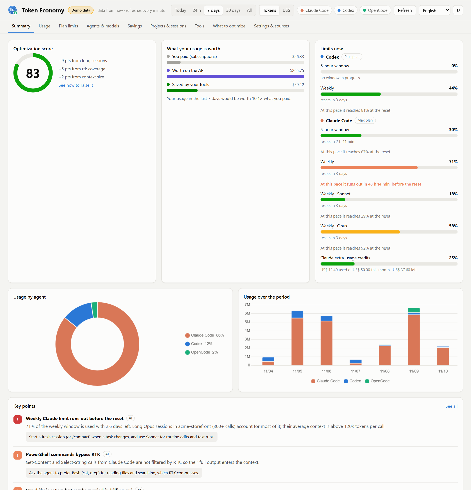
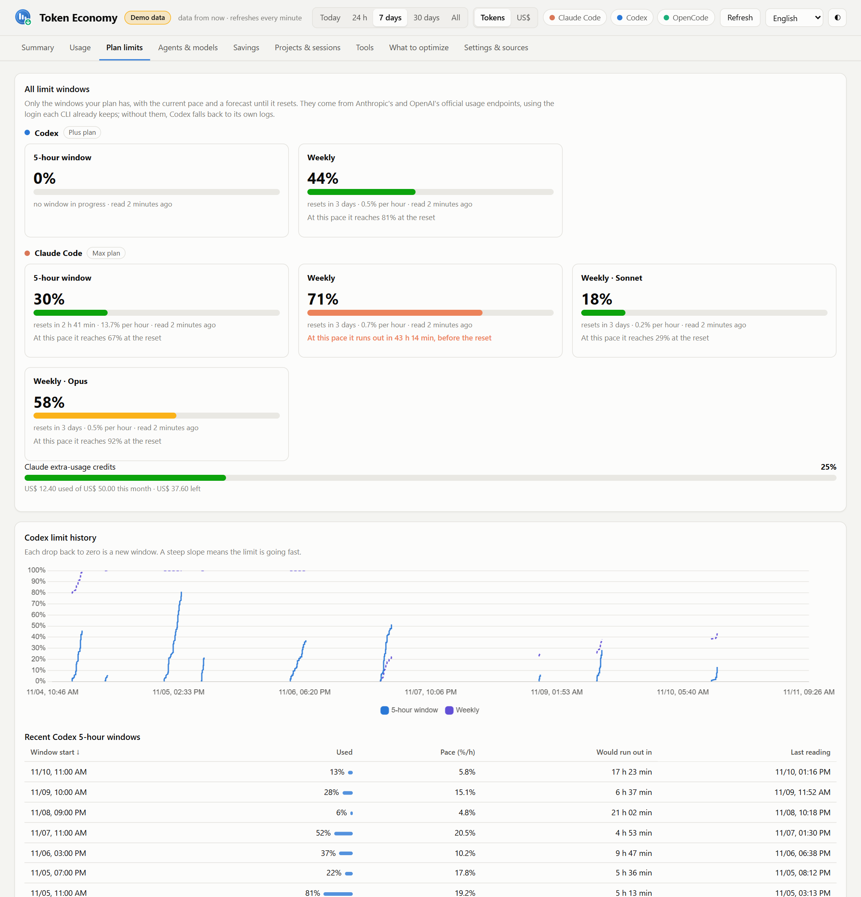
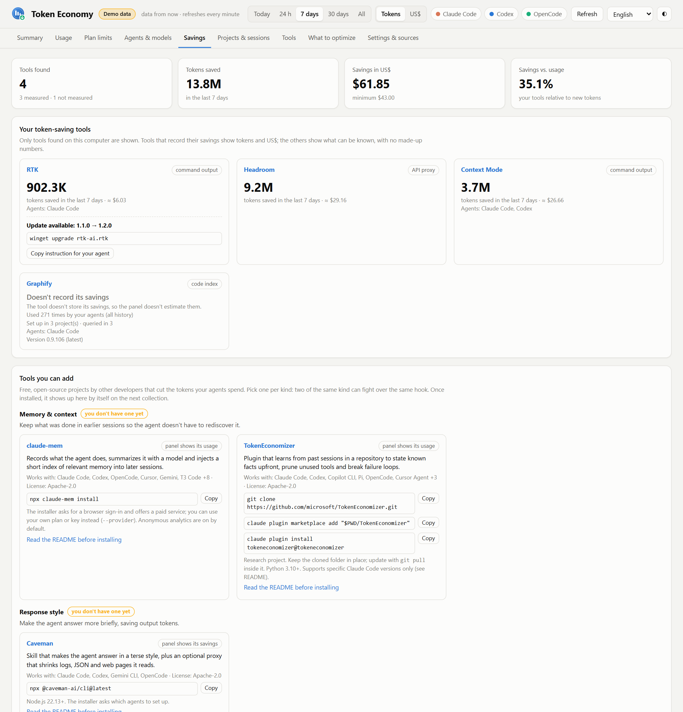
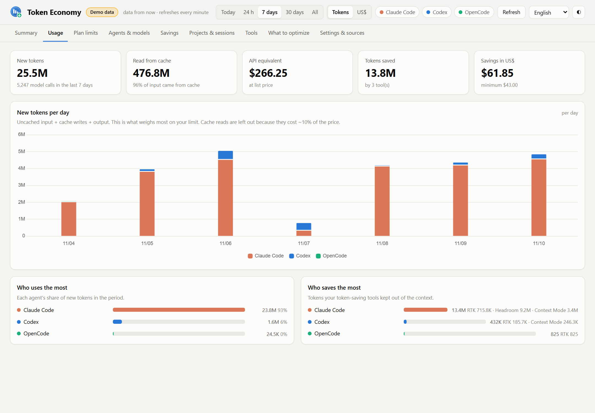
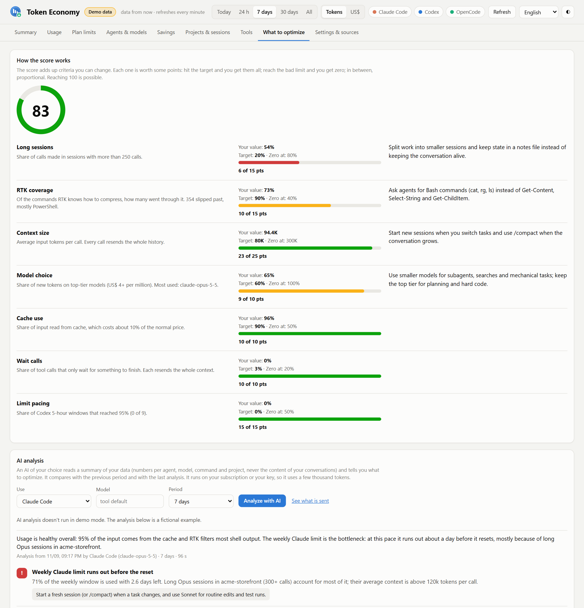

# Token Economy: Claude Code & Codex usage, limits and token savings dashboard

**See how many tokens your AI coding agents burn, how close you are to your Claude Code and Codex plan limits, and how much your token-saving tools (RTK, Headroom, Context Mode, Graphify…) actually save.** A local dashboard and tray app for Windows, macOS and Linux. No account, no telemetry: it reads the logs already on your machine.

[Português](README.pt-BR.md) · [Español](README.es.md) · [Support the project](#support-the-project)



## Why

Claude Code, Codex, OpenCode and friends spend millions of tokens a week, and each one hides its numbers in a different place. Token Economy puts them side by side:

- **Plan limits in real time.** Claude Code 5-hour and weekly windows (including per-model weekly quotas), Codex 5-hour and weekly windows, with a forecast: "at this pace you reach 81% when it resets", or "runs out in 3 days, before the reset".
- **Token usage per agent, model, project and session.** Input, output, cache reads and cache writes, by day.
- **What your usage would cost on the API**, compared with what you actually pay for your subscriptions, prorated to the period you are looking at.
- **Token-saving tools, measured honestly.** It detects which tools you have installed and shows only those. Tools that record their savings show tokens and US$; tools that don't say so, and show where they are set up and how often your agents used them. It never invents a number.
- **An optimization score** with the criteria behind it, automatic tips, and an optional AI analysis using the CLI subscription you already pay for.

Everything runs on `127.0.0.1`. The dashboard is in English, Portuguese and Spanish.

## Screenshots

| Plan limits | Token-saving tools |
|---|---|
|  |  |
| **Usage by agent and model** | **What to optimize** |
|  |  |

Screenshots use the built-in demo data (`python server.py --demo`), not a real account.

## Install

Token Economy runs on **Windows 10/11**, **macOS** and **Linux** with **Python 3.10+**. Windows is the most tested; macOS and Linux support is new, so please [open an issue](https://github.com/Baeta78/token-economy/issues) if something looks off.

Get the code with `git clone https://github.com/Baeta78/token-economy.git`, or download the ZIP from the green **Code** button and unzip it anywhere. Then follow the steps for your system.

### Windows

1. Install Python from [python.org](https://www.python.org/downloads/) and tick **"Add to PATH"** in the installer.
2. In the `token-economy` folder, install the two packages the tray icon needs:
   ```
   pip install pystray pillow
   ```
3. Double-click **`Token Economy.vbs`**. An icon appears in the tray, next to the clock.

Windows 11 hides new tray icons behind the `^` arrow. To keep it visible, drag it to the taskbar, or turn it on in *Settings > Personalization > Taskbar > Other system tray icons*.

### macOS

1. Install Python 3.10+ from [python.org](https://www.python.org/downloads/) or with Homebrew (`brew install python`).
2. In Terminal, inside the `token-economy` folder, create a virtual environment and install the packages:
   ```
   python3 -m venv .venv
   .venv/bin/pip install pystray pillow
   ```
3. Start the menu bar icon:
   ```
   sh start.sh --tray
   ```
4. The first time it reads your Claude limits, macOS asks whether Python may use the **"Claude Code-credentials"** item in your Keychain. That is the login Claude Code saved; choose **Always Allow** so it doesn't ask again. If you deny it, everything else works and only the Claude limits stay empty.

### Linux

1. Install Python 3.10+ and the tray icon support. On Debian / Ubuntu:
   ```
   sudo apt install python3-venv python3-gi gir1.2-ayatanaappindicator3-0.1
   ```
   On Fedora: `sudo dnf install python3-gobject libayatana-appindicator-gtk3`.
2. Inside the `token-economy` folder, create a virtual environment that can see those system packages, and install the rest:
   ```
   python3 -m venv --system-site-packages .venv
   .venv/bin/pip install pystray pillow
   ```
3. Start the tray icon:
   ```
   sh start.sh --tray
   ```

GNOME shows tray icons only with the *AppIndicator* extension (preinstalled on Ubuntu). KDE, XFCE, Cinnamon and most other desktops show them out of the box.

### Using the tray / menu bar icon

| | Windows | macOS | Linux |
|---|---|---|---|
| See the summary (limits and today's tokens) | hover the icon, or right-click | click the icon | click the icon |
| Open the dashboard | click the icon, or *Open panel* | *Open panel* in the menu | *Open panel* in the menu |
| Start automatically | *Start with Windows* | *Start at login* | *Start at login* |
| Quit | *Quit* | *Quit* | *Quit* |

The icon color follows your tightest limit across all agents: green below 50%, yellow from 50%, orange from 70%, red from 90%, gray with no data. The dashboard opens in its own window when Chrome, Edge, Brave or Chromium is installed, and in your default browser otherwise.

*Start at login* creates `Token Economy.vbs` in the Windows Startup folder, `~/Library/LaunchAgents/com.token-economy.tray.plist` on macOS, or `~/.config/autostart/token-economy.desktop` on Linux. Unticking it deletes that file.

### Browser only, no tray icon

| Windows | macOS / Linux |
|---|---|
| double-click `start.bat`, or run `python server.py` | `sh start.sh` |

It opens http://127.0.0.1:8765 in your browser. Options: `--port 8765`, `--interval 60` (seconds between reads), `--no-browser`, `--demo` (fictional data, to try it out). This mode needs no extra packages. Stop it with `Ctrl+C`.

### Updating and removing

*Settings & sources > Check for updates* tells you when a new version is out and can install it. Your settings and history live in `.cache/` and are kept.

To remove it, untick *Start at login* (or *Start with Windows*), quit the icon and delete the `token-economy` folder. Apart from the two Python packages, nothing is installed anywhere else.

## What it reads

Everything is read locally and read-only.

| Source | Where | What you get |
|---|---|---|
| Claude Code | `~/.claude/projects/**/*.jsonl` | tokens per call, model, project, tools used |
| Claude plan limits | Anthropic's official usage endpoint, with the login Claude Code already keeps in `~/.claude/.credentials.json` (the Keychain on macOS) | 5-hour, weekly and per-model weekly windows (whatever your plan has), plan name, extra usage. The token goes only to Anthropic and is never saved or shown. Can be turned off in Settings |
| Codex | `~/.codex/sessions/**/rollout-*.jsonl` and the official usage endpoint the Codex CLI uses | tokens per turn, 5-hour and weekly windows, plan |
| OpenCode | `~/.local/share/opencode/opencode.db` | tokens and cost per response, including local Ollama models |
| Ollama | `%LOCALAPPDATA%/Ollama/server*.log` (Windows), `~/.ollama/logs/server*.log` (macOS/Linux) | requests and generation time (Ollama doesn't log tokens) |
| Token-saving tools | each tool's own database or log (table below) | tokens saved, per agent and per day |

Tools and agents you don't have are simply left out.

## Token-saving tools

Token Economy looks at programs on your PATH, hooks and MCP servers registered in Claude Code, Codex, OpenCode and Gemini CLI, installed skills and plugins, and each tool's data folder. It reads names and commands only, never secrets.

Tools that store their savings show tokens and US$: a **minimum** (saved output counted once, at the input price of the agent's model) and an **estimate** that also counts the cache re-reads the saved output would have caused until compaction or the end of the session. The same math is used for every tool, so the numbers are comparable.

Tools that don't store their savings show which projects they are set up in and how many times your agents queried them in each project.

| Tool | Kind | Savings measured | Read from |
|---|---|---|---|
| [RTK](https://github.com/rtk-ai/rtk) | command output | yes | `history.db` |
| [Headroom](https://github.com/headroomlabs-ai/headroom) | API proxy | yes | `~/.headroom/savings_events.jsonl` |
| [token-saver](https://github.com/ppgranger/token-saver) | command output | yes | `savings.db` |
| [squeez](https://github.com/claudioemmanuel/squeez) | command output | yes | `<agent>/squeez/sessions/*.jsonl` |
| [Context Mode](https://github.com/mksglu/context-mode) | large outputs, web | yes | `~/.context-mode/projects/*/context.db` |
| [lean-ctx](https://github.com/yvgude/lean-ctx) | command output | yes | `stats.json` |
| [Token Optimizer](https://github.com/alexgreensh/token-optimizer) | command output | yes | `trends.db` |
| [Caveman](https://github.com/JuliusBrussee/caveman) | response style | yes, in proxy mode | `~/.caveman/caveman.db` |
| [Kompact](https://github.com/npow/kompact) | API proxy | yes, while the proxy runs | `http://127.0.0.1:7878/api/metrics` |
| [Code Context Engine](https://github.com/elara-labs/code-context-engine) | code index | yes | `~/.cce/projects/*/memory.db` |
| [jCodeMunch](https://github.com/jgravelle/jcodemunch-mcp) | code index | yes | `~/.code-index/_savings.json` |
| [Graphify](https://github.com/safishamsi/graphify) | code graph | usage per project | — |
| [Serena](https://github.com/oraios/serena) | code index | usage per project | — |
| [CodeGraph](https://github.com/colbymchenry/codegraph) | code index | usage per project | — |
| [codebase-memory-mcp](https://github.com/DeusData/codebase-memory-mcp) | code index | usage per project | — |
| [Claude Context](https://github.com/zilliztech/claude-context) | code index | usage | — |
| [Token Reducer](https://github.com/Madhan230205/token-reducer) | code index | usage per project | — |
| [claude-mem](https://github.com/thedotmack/claude-mem) | memory | usage | — |
| [TokenEconomizer](https://github.com/microsoft/TokenEconomizer) | memory | usage | — |

**Starting from zero?** The *Savings* tab also lists the tools you don't have yet, grouped by what they do, with a one-line description, the official install command from each project's README and whether the panel will show its savings or only its usage. For the tools you already have, the panel compares the installed version with the latest one and, when there is an update, shows the official update command and a button that copies a ready-made instruction to paste into your own agent. The panel itself never installs or updates anything. Kinds you have nothing for come first, and *What to optimize* and the AI analysis point you there when your data shows the matching problem.

Every entry was checked against the tool's own source code. The list lives in `savings_tools.json`. Missing a tool? See [CONTRIBUTING.md](CONTRIBUTING.md).

## Dashboard tabs

- **Summary:** optimization score, what your usage is worth versus what you pay, current limits, usage by agent and over time, top insights.
- **Usage, Plan limits, Agents & models, Savings, Projects & sessions, Tools:** the detail behind each number.
- **What to optimize:** how the score is built, the AI analysis and the automatic rules.
- **Settings & sources:** your subscriptions, price tables, where each number comes from, and updates.

The **Tokens / US$** switch at the top shows every chart in tokens or in what the same usage would cost on the pay-per-token API.

### Prices

Prices come from public tables the dashboard downloads and refreshes weekly: [LiteLLM](https://github.com/BerriAI/litellm) (thousands of models from every provider), then the [OpenRouter](https://openrouter.ai) catalog. Your own values in `prices.json` win; `default_prices.json` is the offline fallback. The Sources tab lists the price and source used for each model.

### Subscriptions

In Settings, add each subscription with its monthly price and agent. The dashboard prorates it to the selected period (7 days of a US$ 100/month plan ≈ US$ 23) and compares it with the API value of your usage.

### Optimization score

A 0–100 score computed from things you can change: average context size, calls in very long sessions, cache use, share of tokens on top-tier models, how many compressible commands went through RTK, tool calls that only wait, and how often your 5-hour windows hit 95%. Each criterion shows your value, the target, the points and what to do. Criteria without data are left out.

### AI analysis

Under *What to optimize*, pick an AI and click **Analyze with AI**. It reads a summary of your numbers (never your conversations), compares with the previous period and the last analysis, and returns a score and concrete recommendations. You can connect:

- **An installed CLI**, using the subscription you already pay for: Claude Code, Codex, Gemini CLI, Qwen Code, Grok CLI, Cursor Agent, GitHub Copilot CLI, OpenCode, Factory Droid, Amp, Kimi or Ollama.
- **Any OpenAI-compatible API**: OpenAI, xAI, OpenRouter, Google Gemini, Groq, DeepSeek, Mistral, Ollama, LM Studio. The key stays in `.cache/config.json` on your machine, or use `$ENV_VAR_NAME`.
- **A custom command** that reads the prompt from stdin and prints the JSON answer.

The prompt is in `prompts/analysis.md`; *See what is sent* shows the exact text.

## FAQ

**How do I see my Claude Code weekly limit outside the terminal?**
Token Economy reads it from Anthropic's official usage endpoint with the login Claude Code already has, and shows it in the tray and on the *Plan limits* tab, with a forecast of when you'll run out.

**Why does my Codex 5-hour limit run out so fast?**
Open *Agents & models* and *Projects & sessions*: they show which model, project and session used the most tokens, and *What to optimize* points at the usual causes (very long sessions, large contexts, top-tier models for small tasks).

**Does RTK / Headroom / Context Mode really save tokens? How much?**
For tools that record it, the *Savings* tab shows tokens and dollars per day and per agent, from the tool's own data.

**Is my data sent anywhere?**
No. Logs are read locally. The only outgoing requests are the public price tables, the official usage endpoints of your own Claude and Codex accounts (can be turned off), the update check against this GitHub repository, the latest-version lookup of the token-saving tools you have installed (PyPI, npm, crates.io or GitHub, sending only the package name, at most every 12 hours), and the AI analysis when you start it.

**Does it work with a Claude Pro / Max / Ultra or ChatGPT Plus / Pro subscription?**
Yes. It shows the windows your plan has, and the plan name comes from your account, so plan changes appear automatically.

**macOS or Linux?**
Yes, both are supported: `sh start.sh` for the dashboard, `sh start.sh --tray` for the menu bar / tray icon. The support is new and mostly tested on Windows, so bug reports from macOS and Linux users are very welcome.

## Project files

- `tray.py`: the tray / menu bar app; starts the server and the data collection.
- `start.bat`, `Token Economy.vbs` (Windows) and `start.sh` (macOS/Linux): launchers.
- `server.py`: local server on `127.0.0.1`, collects every minute and serves the page. Only the dashboard page can change settings (requests need a header other websites can't send).
- `collector.py`: reads every source and builds the numbers. `python collector.py` runs it alone.
- `limits.py`: Claude and Codex plan limits.
- `signals.py`, `savings.py`, `savings_tools.json`: token-saving tool detection and savings readers.
- `prices.py`, `prices.json`, `default_prices.json`: prices.
- `ai.py`, `ai_providers.json`, `prompts/analysis.md`: the AI analysis.
- `static/`: the page. Translations in `static/i18n.js`. Charts use Chart.js from cdnjs.
- `.cache/`: read positions, downloaded price tables, settings, limit history, past analyses and `tray.log`. Private to your machine; deleting it only resets settings and history.

## Limitations

- RTK token counts are estimates (bytes ÷ 4), the same as `rtk gain`; outputs above 7,500 tokens are left out.
- The agent behind each RTK command is inferred by matching it against the commands each agent ran; about 5% stays unidentified. Code Context Engine, jCodeMunch and lean-ctx don't record which agent used them.
- Claude limits need Claude Code to be logged in on this machine.

## Support the project

Token Economy is free and maintained in spare time. If it saves you tokens, you can help keep it going:

- ⭐ **Star the repository**: it helps other people find it.
- 🐛 **Open issues and pull requests**: new tools, agents and translations are welcome ([CONTRIBUTING.md](CONTRIBUTING.md)).
- 💛 **Donate**: [GitHub Sponsors](https://github.com/sponsors/Baeta78) (card, worldwide), ⚡ Lightning or ɱ Monero:

⚡ **Lightning Address** (any wallet): `twilightsunset24638@getalby.com`

⚡ **Lightning BOLT12** (Phoenix, Zeus and others):

```
lno1pgqppmsrse80qf0aara4slvcjxrvu6j2rp5ftmjy4yntlsmsutpkvkt6878s8rytce47qg38ct5a66vhqlakc3qnyfn6838lrxcem0x5p9qx2x36qgp9gyxfmkfdlc8cgve57jyc727ayksec6v99y77y759fzvcxmyrvhgqxwwxyqwwan3edglpe66hwlevdp65w5d2nk0ulmlpkjwgs5eed8exdjkax4d32djd4zju2zcfmz72h5qnhw8qyafldfxfsmxteqy4jrafst24q8ap5wshgqkhcfkfldn5geqcxjruqqeg2985wkk8heuw2k2xrlhlvapgrtsplfuy72z639w2g8arzgseqmcyn8wd49yu2ylsr3wr2kw6ka7rswrs
```

ɱ **Monero**:

```
833KcUPVCZvFbjDnNeMP8UDqbJjtnP29tPLxtsQLENiWQoPhrKQpBR9McQTemcDEAffFhtTNkJeRSWmLb4sGScPa3YLVBGa
```

Only the addresses in this official repository are ours.

## License and commercial use

Token Economy is free software under the [GNU Affero General Public License v3.0](LICENSE): you can use it, including at work, study it, change it and share it. If you distribute a modified version, build it into another program, or offer it to others as a network service, that program must also be released under the AGPL-3.0 with its full source code.

**Commercial license.** To use Token Economy in a closed-source product or service without the AGPL-3.0 obligations, a commercial license is available. [Open a commercial license request](https://github.com/Baeta78/token-economy/issues/new?template=commercial_license.md).
