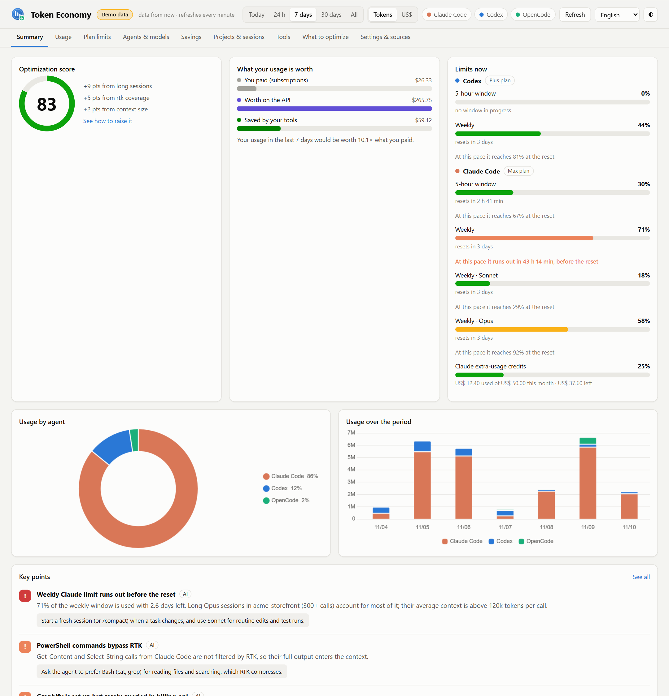
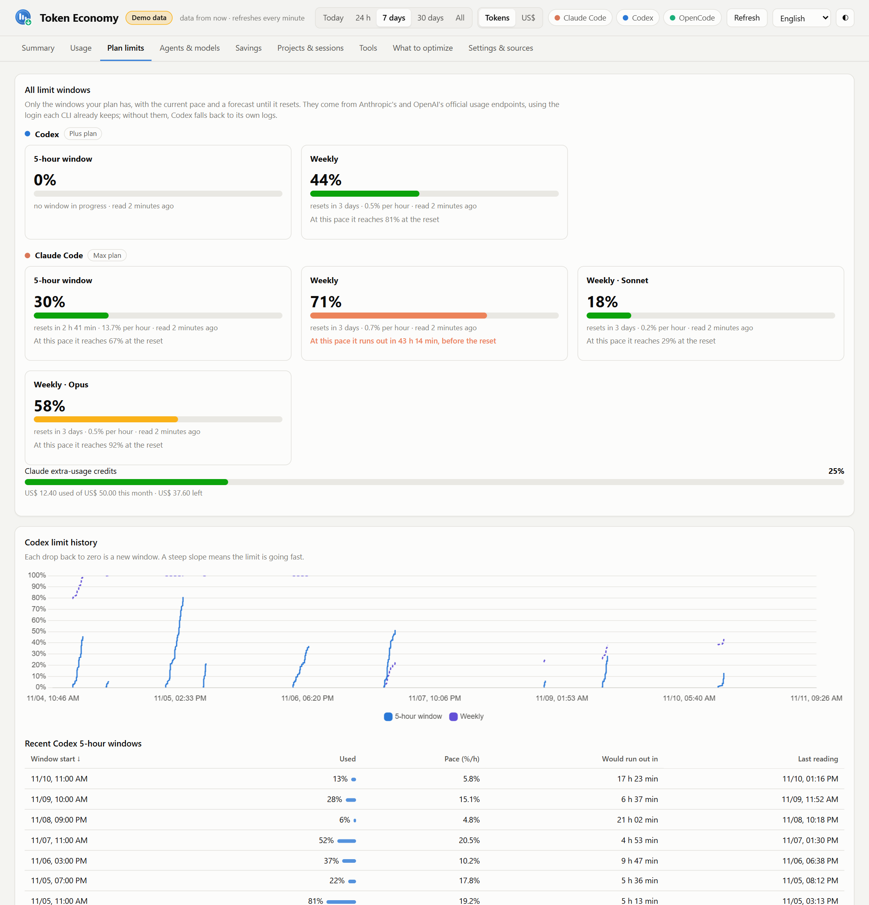
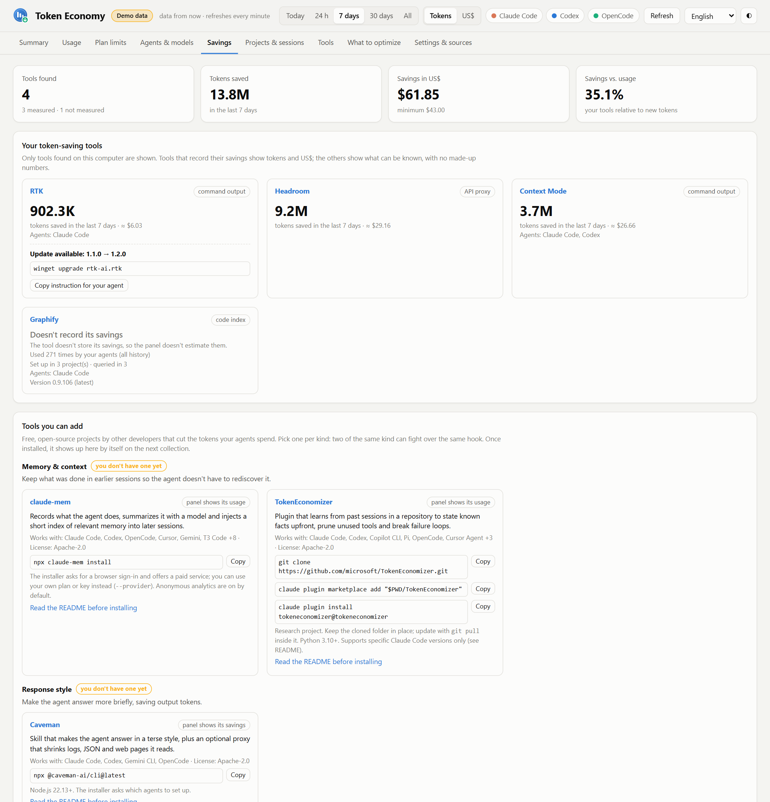
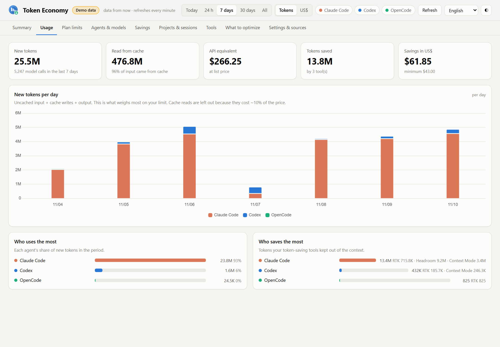
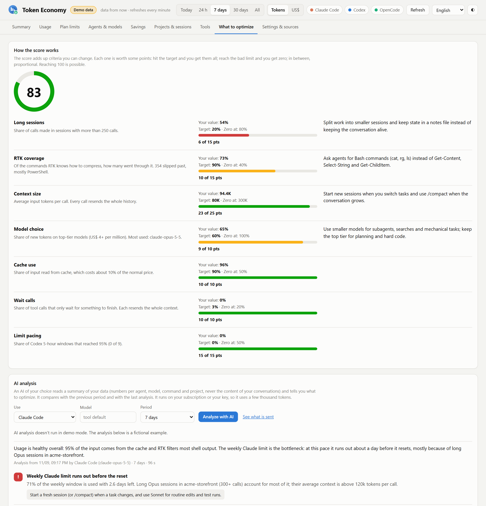

# Token Economy: painel de consumo, limites e economia de tokens do Claude Code e do Codex

**Veja quantos tokens seus agentes de IA gastam, o quanto falta para os limites do plano do Claude Code e do Codex, e quanto suas ferramentas de economia (RTK, Headroom, Context Mode, Graphify…) economizam de verdade.** Painel local e app de bandeja para Windows, macOS e Linux. Sem conta e sem telemetria: ele lê os registros que já estão no seu computador.

[English](README.md) · [Español](README.es.md) · [Apoie o projeto](#apoie-o-projeto)



## Para que serve

Claude Code, Codex, OpenCode e companhia gastam milhões de tokens por semana, e cada um guarda os números num lugar diferente. O Token Economy coloca tudo lado a lado:

- **Limites do plano em tempo real.** Janelas de 5 horas e semanal do Claude Code (inclusive a cota semanal por modelo) e do Codex, com previsão: "nesse ritmo chega a 81% quando zerar" ou "acaba em 3 dias, antes de zerar".
- **Consumo de tokens por agente, modelo, projeto e sessão.** Entrada, saída, leitura e escrita de cache, por dia.
- **Quanto o seu uso custaria pela API**, comparado com o que você paga nas assinaturas, proporcional ao período escolhido.
- **Ferramentas de economia medidas com honestidade.** O painel detecta o que está instalado e mostra só isso. As que registram a economia mostram tokens e US$; as que não registram dizem isso e mostram em que projetos estão configuradas e quantas vezes os agentes as usaram. Nenhum número é inventado.
- **Uma nota de otimização** com os critérios por trás dela, dicas automáticas e uma análise por IA opcional, usando a assinatura de CLI que você já paga.

Tudo roda em `127.0.0.1`. O painel está em português, inglês e espanhol.

## Prints

| Limites do plano | Ferramentas de economia |
|---|---|
|  |  |
| **Consumo por agente e modelo** | **O que otimizar** |
|  |  |

Os prints usam os dados de demonstração embutidos (`python server.py --demo`), não uma conta real.

## Instalação

Requisitos: **Python 3.10+** ([python.org](https://www.python.org/downloads/); no Windows, marque "Add to PATH") no **Windows 10/11**, **macOS** ou **Linux**. O Windows é o mais testado; o suporte a macOS e Linux é novo, então [abra uma issue](https://github.com/Baeta78/token-economy/issues) se algo parecer errado.

```
git clone https://github.com/Baeta78/token-economy.git
cd token-economy
pip install pystray pillow
```

Ou baixe o ZIP pelo botão verde **Code** e descompacte onde quiser.

**Windows:** dê dois cliques em **`Token Economy.vbs`**. **macOS / Linux:** rode `./start.sh --tray` (ou `python3 tray.py`). Aparece um ícone na bandeja (na barra de menus, no macOS):

- **Mouse em cima:** os limites do plano agora e os tokens de hoje, por agente.
- **Clique:** abre o painel numa janela própria.
- **Botão direito:** o mesmo resumo, mais "Atualizar agora", "Iniciar com o Windows" ("Iniciar ao entrar no sistema" no macOS e Linux) e "Sair".
- **Cor do ícone:** segue o limite mais apertado entre todos os agentes: verde abaixo de 50%, amarelo a partir de 50%, laranja a partir de 70%, vermelho a partir de 90%, cinza sem dados.

No Linux, o GNOME precisa da extensão *AppIndicator* para mostrar ícones de bandeja (KDE, XFCE e a maioria dos outros já mostram). No macOS, na primeira leitura dos limites do Claude, o sistema pede para liberar o item "Claude Code-credentials" do Keychain: escolha *Sempre Permitir*.

O Windows 11 esconde ícones novos na setinha `^`. Para deixar sempre visível, arraste o ícone para a barra ou ative em *Configurações > Personalização > Barra de tarefas > Outros ícones da bandeja do sistema*.

**Só no navegador:** rode `python server.py` (ou dê dois cliques em `start.bat` no Windows, ou `./start.sh` no macOS/Linux) e abra http://127.0.0.1:8765. Opções: `--port 8765`, `--interval 60` (segundos entre leituras), `--no-browser`, `--demo`.

**Atualizações:** *Ajustes > Procurar atualizações* avisa quando sai uma versão nova. Suas configurações e histórico ficam em `.cache/` e são mantidos.

## O que ele lê

Tudo é lido localmente, só leitura.

| Fonte | Onde | O que dá para saber |
|---|---|---|
| Claude Code | `~/.claude/projects/**/*.jsonl` | tokens por chamada, modelo, projeto, ferramentas usadas |
| Limites do plano do Claude | Endpoint oficial de uso da Anthropic, com o login que o Claude Code já guarda em `~/.claude/.credentials.json` (no Keychain, no macOS) | janelas de 5 h, semanal e semanal por modelo (as que o seu plano tiver), nome do plano e uso extra. O token só vai para a Anthropic e não é gravado nem mostrado. Dá para desligar em Ajustes |
| Codex | `~/.codex/sessions/**/rollout-*.jsonl` e o endpoint oficial de uso que a CLI do Codex usa | tokens por turno, janelas de 5 h e semanal, plano |
| OpenCode | `~/.local/share/opencode/opencode.db` | tokens e custo por resposta, inclusive modelos locais do Ollama |
| Ollama | `%LOCALAPPDATA%/Ollama/server*.log` (Windows), `~/.ollama/logs/server*.log` (macOS/Linux) | requisições e tempo de geração (o Ollama não grava tokens) |
| Ferramentas de economia | o banco ou registro de cada ferramenta (tabela abaixo) | tokens poupados, por agente e por dia |

O que você não tem instalado simplesmente não aparece.

## Ferramentas de economia de tokens

O Token Economy olha os programas no PATH, os hooks e servidores MCP registrados no Claude Code, Codex, OpenCode e Gemini CLI, as skills e plugins instalados e a pasta de dados de cada ferramenta. Lê só nomes e comandos, nunca segredos.

As ferramentas que guardam a economia mostram tokens e US$: um **mínimo** (a saída poupada contada uma vez, pelo preço de entrada do modelo do agente) e uma **estimativa** que conta também as releituras de cache que essa saída teria causado até a compactação ou o fim da sessão. A conta é a mesma para todas, então os números são comparáveis.

As que não guardam a economia mostram em que projetos estão configuradas e quantas vezes os agentes as consultaram em cada projeto.

| Ferramenta | Tipo | Economia medida | Lida de |
|---|---|---|---|
| [RTK](https://github.com/rtk-ai/rtk) | saída de comandos | sim | `history.db` |
| [Headroom](https://github.com/headroomlabs-ai/headroom) | proxy da API | sim | `~/.headroom/savings_events.jsonl` |
| [token-saver](https://github.com/ppgranger/token-saver) | saída de comandos | sim | `savings.db` |
| [squeez](https://github.com/claudioemmanuel/squeez) | saída de comandos | sim | `<agente>/squeez/sessions/*.jsonl` |
| [Context Mode](https://github.com/mksglu/context-mode) | saídas grandes, web | sim | `~/.context-mode/projects/*/context.db` |
| [lean-ctx](https://github.com/yvgude/lean-ctx) | saída de comandos | sim | `stats.json` |
| [Token Optimizer](https://github.com/alexgreensh/token-optimizer) | saída de comandos | sim | `trends.db` |
| [Caveman](https://github.com/JuliusBrussee/caveman) | estilo das respostas | sim, no modo proxy | `~/.caveman/caveman.db` |
| [Kompact](https://github.com/npow/kompact) | proxy da API | sim, com o proxy no ar | `http://127.0.0.1:7878/api/metrics` |
| [Code Context Engine](https://github.com/elara-labs/code-context-engine) | índice do código | sim | `~/.cce/projects/*/memory.db` |
| [jCodeMunch](https://github.com/jgravelle/jcodemunch-mcp) | índice do código | sim | `~/.code-index/_savings.json` |
| [Graphify](https://github.com/safishamsi/graphify) | grafo do código | uso por projeto | — |
| [Serena](https://github.com/oraios/serena) | índice do código | uso por projeto | — |
| [CodeGraph](https://github.com/colbymchenry/codegraph) | índice do código | uso por projeto | — |
| [codebase-memory-mcp](https://github.com/DeusData/codebase-memory-mcp) | índice do código | uso por projeto | — |
| [Claude Context](https://github.com/zilliztech/claude-context) | índice do código | uso | — |
| [Token Reducer](https://github.com/Madhan230205/token-reducer) | índice do código | uso por projeto | — |
| [claude-mem](https://github.com/thedotmack/claude-mem) | memória | uso | — |
| [TokenEconomizer](https://github.com/microsoft/TokenEconomizer) | memória | uso | — |

**Começando do zero?** A aba *Economia* também lista as ferramentas que você ainda não tem, agrupadas pelo que fazem, com uma descrição curta, o comando oficial de instalação tirado do README de cada projeto e se o painel vai mostrar a economia ou só o uso. Para as ferramentas que você já tem, o painel compara a versão instalada com a mais nova e, quando há atualização, mostra o comando oficial e um botão que copia uma instrução pronta para você colar no seu próprio agente. O painel em si nunca instala nem atualiza nada. Os tipos que você ainda não cobre aparecem primeiro, e *O que otimizar* e a análise por IA levam você até lá quando os seus dados mostram o problema que a ferramenta resolve.

Cada item foi conferido no código-fonte da própria ferramenta. A lista fica em `savings_tools.json`. Falta alguma? Veja o [CONTRIBUTING.md](CONTRIBUTING.md).

## Abas do painel

- **Resumo:** nota de otimização, quanto vale o seu uso comparado com o que você paga, limites agora, uso por agente e ao longo do tempo, principais pontos.
- **Consumo, Limites dos planos, Agentes e modelos, Economia, Projetos e sessões, Ferramentas:** o detalhe de cada número.
- **O que otimizar:** como a nota é calculada, a análise por IA e as regras automáticas.
- **Ajustes e fontes:** suas assinaturas, tabelas de preço, de onde vem cada número e atualizações.

O seletor **Tokens / US$** no topo mostra todos os gráficos em tokens ou no que o mesmo uso custaria pagando por token na API.

### Preços

Os preços vêm de tabelas públicas que o painel baixa e atualiza toda semana: [LiteLLM](https://github.com/BerriAI/litellm) (milhares de modelos de todos os provedores) e, depois, o catálogo do [OpenRouter](https://openrouter.ai). Seus valores em `prices.json` têm prioridade; `default_prices.json` é a reserva sem internet. A aba Fontes mostra o preço e a fonte usados para cada modelo.

### Assinaturas

Em Ajustes, cadastre cada assinatura com o valor mensal e o agente. O painel calcula a parte proporcional do período escolhido (7 dias de um plano de US$ 100/mês ≈ US$ 23) e compara com o valor do seu uso pela API.

### Nota de otimização

Uma nota de 0 a 100 calculada a partir do que você consegue mudar: tamanho médio do contexto, chamadas em sessões muito longas, aproveitamento do cache, parte dos tokens em modelos de ponta, quantos comandos compressíveis passaram pelo RTK, chamadas de ferramenta que só esperam e quantas vezes as janelas de 5 horas chegaram a 95%. Cada critério mostra seu valor, a meta, os pontos e o que fazer. Critérios sem dados ficam de fora.

### Análise por IA

Em *O que otimizar*, escolha uma IA e clique em **Analisar com IA**. Ela lê um resumo dos seus números (nunca as conversas), compara com o período anterior e com a última análise, e devolve uma nota e recomendações concretas. Dá para conectar:

- **Uma CLI instalada**, usando a assinatura que você já paga: Claude Code, Codex, Gemini CLI, Qwen Code, Grok CLI, Cursor Agent, GitHub Copilot CLI, OpenCode, Factory Droid, Amp, Kimi ou Ollama.
- **Qualquer API compatível com OpenAI**: OpenAI, xAI, OpenRouter, Google Gemini, Groq, DeepSeek, Mistral, Ollama, LM Studio. A chave fica em `.cache/config.json` no seu computador, ou use `$NOME_DA_VARIAVEL`.
- **Um comando personalizado** que leia o prompt pela entrada padrão e imprima o JSON da resposta.

O prompt fica em `prompts/analysis.md`; *Ver o que é enviado* mostra o texto exato.

## Perguntas frequentes

**Como vejo o limite semanal do Claude Code fora do terminal?**
O Token Economy lê o limite pelo endpoint oficial de uso da Anthropic, com o login que o Claude Code já tem, e mostra na bandeja e na aba *Limites dos planos*, com a previsão de quando acaba.

**Por que meu limite de 5 horas do Codex acaba tão rápido?**
Abra *Agentes e modelos* e *Projetos e sessões*: elas mostram qual modelo, projeto e sessão mais gastaram, e *O que otimizar* aponta as causas comuns (sessões muito longas, contextos grandes, modelos de ponta para tarefas pequenas).

**RTK, Headroom e Context Mode economizam mesmo? Quanto?**
Para as ferramentas que registram, a aba *Economia* mostra tokens e dólares por dia e por agente, a partir dos dados da própria ferramenta.

**Meus dados vão para algum lugar?**
Não. Os registros são lidos localmente. As únicas conexões de saída são as tabelas públicas de preço, os endpoints oficiais de uso das suas próprias contas do Claude e do Codex (dá para desligar), a verificação de atualização neste repositório do GitHub, a consulta da versão mais nova das ferramentas de economia que você tem instaladas (PyPI, npm, crates.io ou GitHub, enviando só o nome do pacote, no máximo a cada 12 horas) e a análise por IA quando você a inicia.

**Funciona com assinatura Claude Pro / Max / Ultra ou ChatGPT Plus / Pro?**
Sim. Ele mostra as janelas que o seu plano tem, e o nome do plano vem da sua conta, então mudanças de plano aparecem sozinhas.

**macOS ou Linux?**
Sim, os dois têm suporte: `./start.sh` para o painel e `./start.sh --tray` para o ícone na barra de menus / bandeja. O suporte é novo e foi testado sobretudo no Windows, então relatos de quem usa macOS e Linux são muito bem-vindos.

## Arquivos do projeto

- `tray.py`: o app da bandeja / barra de menus; sobe o servidor e a coleta.
- `start.bat`, `Token Economy.vbs` (Windows) e `start.sh` (macOS/Linux): atalhos para iniciar.
- `server.py`: servidor local em `127.0.0.1`, coleta a cada minuto e entrega a página. Só a página do painel consegue mudar configurações (os pedidos exigem um cabeçalho que outros sites não conseguem mandar).
- `collector.py`: lê as fontes e monta os números. `python collector.py` roda só a coleta.
- `limits.py`: limites dos planos do Claude e do Codex.
- `signals.py`, `savings.py`, `savings_tools.json`: detecção das ferramentas de economia e leitura da economia delas.
- `prices.py`, `prices.json`, `default_prices.json`: preços.
- `ai.py`, `ai_providers.json`, `prompts/analysis.md`: a análise por IA.
- `static/`: a página. Traduções em `static/i18n.js`. Os gráficos usam Chart.js do cdnjs.
- `.cache/`: posições de leitura, tabelas de preço baixadas, configurações, histórico dos limites, análises anteriores e `tray.log`. Fica só no seu computador; apagar só zera configurações e histórico.

## Limitações

- Os tokens do RTK são estimados (bytes ÷ 4), igual ao `rtk gain`; saídas acima de 7.500 tokens ficam de fora.
- O agente de cada comando do RTK é deduzido comparando com os comandos que cada agente executou; cerca de 5% fica sem identificação. Code Context Engine, jCodeMunch e lean-ctx não registram qual agente os usou.
- Os limites do Claude precisam do Claude Code logado neste computador.

## Apoie o projeto

O Token Economy é gratuito e mantido no tempo livre. Se ele te ajuda a economizar tokens, dá para ajudar a mantê-lo:

- ⭐ **Dê uma estrela no repositório**: ajuda outras pessoas a encontrá-lo.
- 🐛 **Abra issues e pull requests**: ferramentas, agentes e traduções novas são bem-vindos ([CONTRIBUTING.md](CONTRIBUTING.md)).
- 💛 **Doe**: [GitHub Sponsors](https://github.com/sponsors/Baeta78) (cartão, do mundo todo), ⚡ Lightning ou ɱ Monero:

⚡ **Lightning Address** (qualquer carteira): `twilightsunset24638@getalby.com`

⚡ **Lightning BOLT12** (Phoenix, Zeus e outras):

```
lno1pgqppmsrse80qf0aara4slvcjxrvu6j2rp5ftmjy4yntlsmsutpkvkt6878s8rytce47qg38ct5a66vhqlakc3qnyfn6838lrxcem0x5p9qx2x36qgp9gyxfmkfdlc8cgve57jyc727ayksec6v99y77y759fzvcxmyrvhgqxwwxyqwwan3edglpe66hwlevdp65w5d2nk0ulmlpkjwgs5eed8exdjkax4d32djd4zju2zcfmz72h5qnhw8qyafldfxfsmxteqy4jrafst24q8ap5wshgqkhcfkfldn5geqcxjruqqeg2985wkk8heuw2k2xrlhlvapgrtsplfuy72z639w2g8arzgseqmcyn8wd49yu2ylsr3wr2kw6ka7rswrs
```

ɱ **Monero**:

```
833KcUPVCZvFbjDnNeMP8UDqbJjtnP29tPLxtsQLENiWQoPhrKQpBR9McQTemcDEAffFhtTNkJeRSWmLb4sGScPa3YLVBGa
```

Só os endereços deste repositório oficial são nossos.

## Licença e uso comercial

O Token Economy é software livre sob a [GNU Affero General Public License v3.0](LICENSE): você pode usar, inclusive no trabalho, estudar, modificar e compartilhar. Se distribuir uma versão modificada, embutir o código em outro programa ou oferecê-lo a outras pessoas como serviço pela rede, esse programa também precisa ser publicado sob a AGPL-3.0, com todo o código-fonte.

**Licença comercial.** Para usar o Token Economy num produto ou serviço de código fechado, sem as obrigações da AGPL-3.0, existe uma licença comercial. [Abra um pedido de licença comercial](https://github.com/Baeta78/token-economy/issues/new?template=commercial_license.md).
